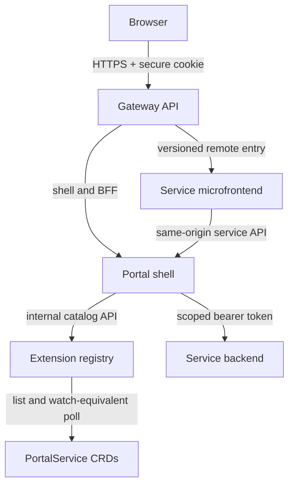

# Atlas Runtime Service Portal

Atlas is a working Kubernetes-native portal in which independently released services contribute tabs at runtime. The portal shell is never rebuilt when a service is registered, upgraded, disabled, or removed.

The repository includes the authenticated React shell/BFF, a Kubernetes-backed extension registry, a versioned extension contract, Inventory and Audit example services, self-contained Web Component microfrontends, four independent images and Helm charts, Gateway API routing, local lifecycle demonstrations, CI/CD, observability assets, and automated tests.

## What works

- The shell discovers tabs from the registry every five seconds and supports deep links and refreshes.
- Inventory and Audit ship as independent backends, microfrontends, images, charts, versions, pipelines, and rollback units.
- Inventory can declaratively add a second Suppliers tab without a shell change.
- A service can be upgraded from `inventory-overview-v1` to `inventory-overview-v2`, rolled back, disabled, unregistered, and restored while the shell stays running.
- Development authentication provides Viewer, Operator, and Administrator identities. Production uses OIDC Authorization Code with PKCE and encrypted, `HttpOnly`, `SameSite` session cookies.
- The BFF filters tabs for usability; every backend validates the bearer token and required permissions again.
- Remote entries require an allowlisted HTTPS/same-origin URL and SHA-384 Subresource Integrity metadata.
- Remote script failures, unavailable services, and render failures are isolated to the active tab.

## Architecture



The browser never accesses Kubernetes. Gateway routes are owned by each service release. The registry has read-only RBAC for `PortalService` resources. The BFF is the only public API path and prevents tokens from entering frontend JavaScript.

See [architecture](docs/architecture.md), [extension contract](docs/extension-contract.md), and [ADRs](docs/adr/README.md).

## Quick start

Prerequisites: Node.js 24+ and npm 11+.

```bash
npm ci
npm run dev
```

Open `http://localhost:4000`. `npm run dev` generates random local-only secrets in ignored `.env`, builds every workspace, computes remote-entry SRI values, and starts all four processes.

Docker is an alternative:

```bash
npm run setup
docker compose up --build --wait
```

### Live lifecycle demonstration

Run these in another terminal while `npm run dev` is active. The UI updates within five seconds.

```bash
node scripts/demo-lifecycle.mjs suppliers   # adds a third tab
node scripts/demo-lifecycle.mjs upgrade     # Inventory 1.0.0 -> 1.1.0 / v2 element
node scripts/demo-lifecycle.mjs rollback    # returns to 1.0.0 / v1 element
node scripts/demo-lifecycle.mjs disable     # tab disappears; service process stays up
node scripts/demo-lifecycle.mjs delete      # unregisters the service
node scripts/demo-lifecycle.mjs register    # restores the service
```

## Validation

```bash
npm run typecheck
npm run test:unit
npm run build
npm run integrity:check
npm run test:e2e
npm run validate
```

The test inventory includes contract, unit, component, BFF integration, backend authorization, idempotency, SRI/origin security, catalog failure isolation, and lifecycle tests. Playwright exercises desktop/mobile login, permission-aware tabs, remote loading, deep-link refresh, and removed routes. CI also lints/renders every Helm chart, validates Kubernetes objects, scans dependencies/images, and produces SBOMs.

## Kubernetes

Required cluster capabilities:

- Kubernetes 1.30+
- a Gateway API v1 controller (the Kind workflow installs Envoy Gateway)
- Metrics Server when HPA is enabled
- an existing TLS Secret for staging/production
- an existing `atlas-platform-secrets` Secret; no chart creates credentials

Create a local cluster and install six independent Helm releases:

```bash
npm run kind:create
npm run kind:install
scripts/port-forward.sh
```

For an existing cluster, create the secret from your secret manager and run:

```bash
scripts/install-platform.sh staging
```

Environment overlays are under `deploy/environments/{dev,staging,production}`. Replace the example hostnames and issuer/client IDs in your environment repository before production reconciliation.

### Independent operations

```bash
# Scale only Inventory
kubectl -n atlas-platform scale deployment/inventory --replicas=5

# Enable its optional second tab
scripts/extension.sh suppliers

# Atomic upgrade; Helm restores the previous release if readiness fails
INVENTORY_IMAGE_TAG=1.1.0 INVENTORY_SRI='sha384-…' scripts/extension.sh upgrade

# Roll back only Inventory
scripts/extension.sh rollback 1

# Hide or restore its tabs without touching the shell
scripts/extension.sh disable
scripts/extension.sh enable

# Unregister its tabs, or uninstall its full release
scripts/extension.sh delete
helm uninstall atlas-inventory -n atlas-platform
```

## Repository structure

| Path | Responsibility | Release unit |
|---|---|---|
| `apps/portal-shell` | React shell, OIDC session handling, catalog filtering, service BFF | `portal-shell` image/chart |
| `apps/extension-registry` | Filesystem/Kubernetes catalog adapters, health, audit lifecycle events | `extension-registry` image/chart |
| `services/inventory` | Inventory API and two versioned Web Component tabs | `inventory` image/chart |
| `services/audit` | Protected audit API and tab | `audit` image/chart |
| `services/github-webhooks` | Direct GitHub receiver, RabbitMQ worker, delivery store/recovery, and portal tab | `github-webhooks` image/chart |
| `packages/contracts` | Versioned manifest and browser element contract | shared build-time package |
| `packages/service-kit` | auth, metrics, traces, retries, circuit breaker, health | shared build-time package |
| `deploy/charts/platform` | Gateway and namespace default-deny policy only | foundation Helm release |
| `deploy/observability` | Prometheus alerts, ServiceMonitor, Grafana dashboard, OTel example | operations assets |
| `catalog` / `examples/catalog` | Local source-of-truth and lifecycle variants | development only |

Shared packages are bundled into each deployable. Microfrontends do not import shared runtime libraries from the shell, so a shared dependency cannot couple their releases.

## Security and operations

- OIDC code flow + PKCE, encrypted cookies, state validation, secure defaults, origin-bound CSRF checks
- backend JWT issuer/audience/algorithm validation and permission enforcement
- CSP, no framing, no object sources, no frontend tokens, output escaping, one-megabyte request limits
- SSRF-safe catalog upstream validation, path normalization, response limits, timeouts, bounded retries, circuit breakers
- SRI, origin allowlists, immutable image tags/digests, restricted containers, dedicated ServiceAccounts, read-only filesystems
- default-deny and per-workload NetworkPolicies, PDBs, HPA, topology spreading, rolling updates, startup/readiness/liveness probes
- structured redacted logs, correlation IDs, Prometheus metrics, OTLP traces, build metadata, audit lifecycle events, alerts and SLOs
- CI dependency/image scanning, CodeQL, SBOM, keyless image signing and GitHub build provenance on releases

Detailed runbooks are in [operations](docs/operations.md), [testing](docs/testing.md), [threat model](docs/threat-model.md), and [SLOs](docs/slo.md).

## Deliberate limitations

- Example business data is immutable process data so the reference platform does not prescribe a database. A real service must own its database and backward-compatible migrations.
- Production identity claim names vary by provider; `PERMISSIONS_CLAIM` and `ROLES_CLAIM` are configurable and must be mapped in the IdP.
- The reference uses a five-second Kubernetes catalog poll instead of a long-lived watch. This bounds reconnect complexity and API load for a low-churn catalog; an informer can replace the adapter without changing the public contract.
- Cross-origin remote entries are supported for local development. Production examples use same-origin Gateway routes, which simplify CSP, SRI, cookies, and operations.

