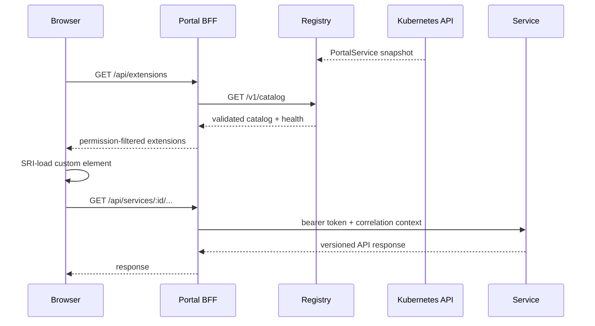

# Architecture

## Context and boundaries

Atlas separates product composition from service ownership. The shell owns navigation, session handling, layout, accessibility, theme tokens, runtime loading, and fallback states. It does not contain service routes or import service code. A service owns its API, business rules, data, remote entry, `PortalService` registration, Gateway route, image, Helm chart, and release history.

The extension registry is a control-plane read model. In Kubernetes it polls namespaced `PortalService` custom resources with `get/list/watch` RBAC; locally it watches a directory. It validates each resource independently, rejects conflicting IDs/routes, checks health, retains the last-known-good snapshot if the source fails, and emits structured audit events when registrations change.

The portal server is both static shell server and BFF. It authenticates with a central OIDC provider, keeps access tokens inside an encrypted cookie, filters the catalog using permissions, validates upstream targets, and proxies service calls with short-lived/scoped bearer credentials. Services validate tokens and permissions again.

## Request and discovery flows

Registration is eventually consistent within five seconds. A new service chart creates its Deployment, Service, HTTPRoute, and PortalService. The Gateway begins serving the remote entry; the registry validates the CR; the next shell poll adds the tab. Disablement or deletion follows the reverse path.

## Failure domains

| Failure | Containment |
|---|---|
| invalid manifest | registry rejects only that resource and logs the reason |
| duplicate ID or route | conflicting resource is isolated deterministically |
| registry outage | BFF serves its last-known-good snapshot with unknown health |
| remote 404/SRI mismatch/syntax error | loader shows tab error; shell and other tabs stay mounted |
| custom element render error | remote catches its own async error; React boundary handles host failures |
| backend unavailable | health status and circuit breaker return a per-service 503 |
| unauthorized tab | BFF hides it; backend independently returns 403 if called directly |
| failed rollout | readiness blocks traffic and `helm upgrade --atomic` restores the previous release |

## Communication and data

The examples need only request/response communication, so no event broker is deployed. Introducing a broker for registration would create operational work without a product benefit. A future service may own an asynchronous contract when the producer must not wait for consumers; such events must be versioned, idempotently consumed, and placed behind an outbox if coupled to a database transaction.

Services never share private schemas. The reference examples intentionally have no database. A stateful service adds its own datastore, migrations, backup/restore, and SLO within its release boundary.

## Runtime compatibility

- Shell contract: `portal.atlas.dev/v1alpha1`
- Portal API version: `1.0.0`
- Every extension declares SemVer `portalCompatibility`, `extensionVersion`, and `apiVersion`.
- IDs and routes are stable. Custom-element names are versioned, allowing v1 and v2 to coexist in an already-open browser during an upgrade.
- Remote URLs and image tags are immutable per release; SRI changes are committed with the service release.
- APIs use additive changes first. Breaking changes require a new major path and a migration window in which both versions run.

## Deployment topology

Foundation, shell, registry, Inventory, and Audit are separate Helm releases. The foundation owns only Gateway and default-deny policy; therefore the convenience installer does not turn service charts into one rollback unit. Each component has independent scaling, image, chart version, rollout history, PDB, and pipeline.

