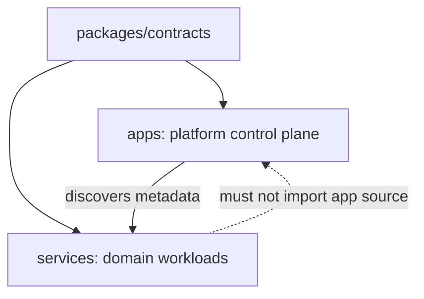
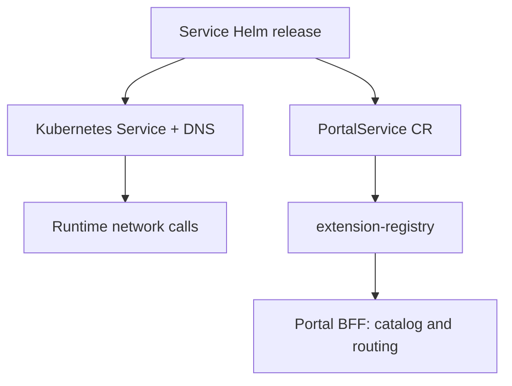

# Service boundaries, registration, and future evolution

## Purpose

This document defines how Atlas services are separated today, where the current
monorepo still couples them, and how that coupling should be removed without
changing the runtime architecture all at once. It is the decision guide for:

- choosing between `apps/` and `services/`;
- adding a service with an API but no portal UI;
- deciding whether a workload must be registered with the portal;
- understanding portal registration versus Kubernetes service discovery;
- reviewing changes that touch files outside one service directory; and
- evolving the repository toward zero-touch service onboarding.

The short version is:

1. `apps/` contains the platform control plane; `services/` contains domain and
   integration workloads that use the platform.
2. An API-only service is supported today by registering a `PortalService` with
   `extensions: []`.
3. A worker that has no portal API or UI does not need a `PortalService` at all.
4. Atlas already has a portal service catalog, implemented by
   `extension-registry`. Kubernetes `Service` objects and CoreDNS provide
   runtime network discovery. These solve different problems.
5. Do not add Consul, Eureka, or another general-purpose registry only to find
   services inside Kubernetes.
6. Runtime releases are already independent. Source onboarding and build
   metadata are not yet completely independent because several root files
   enumerate the workspaces.

## What “independent” means

Independence is not a single property. A service can be independent in one
dimension and coupled in another.

| Dimension | Desired property | Current state |
|---|---|---|
| Code | Business logic, API, worker, UI extension, and tests are owned by the service | Mostly independent |
| Runtime | The service can scale, fail, roll out, and roll back without another component | Independent |
| Release | The service has its own image, chart, version, and pipeline | Independent, with some centrally enumerated workflow metadata |
| Build | Building one service does not require editing or rebuilding unrelated services | Partially coupled by the root npm workspace and shared lockfile |
| Registration | Portal routes and UI appear without changing portal source | Independent through `PortalService` |
| Onboarding | Creating a new service changes only its own directory | Not yet; root scripts, workflows, local orchestration, and environment files enumerate services |
| Repository | A team can clone, test, and release the service without the platform repository | Not provided by the current monorepo |

This distinction explains the apparent contradiction in the current design:
services are independently deployable, but adding a brand-new service still
requires several integration changes in the shared repository. That is a
tooling limitation, not a required property of the portal architecture.

## `apps/` versus `services/`

The directory names are ownership and dependency rules. They are not
Kubernetes primitives and they do not mean “has a UI” versus “has no UI.”

| Question | `apps/` | `services/` |
|---|---|---|
| Primary purpose | Operate, secure, or compose the Atlas platform | Deliver a business, domain, or integration capability |
| Typical owner | Central platform team | Domain or integration team |
| Expected population | Small and stable | Grows as capabilities are added |
| Dependency direction | Defines contracts consumed by services | Consumes platform contracts; must not be required by platform startup |
| Portal UI | Platform shell and navigation may live here | A service may contribute zero, one, or many independently released microfrontends |
| Portal registration | Usually platform configuration | Service owns its `PortalService` registration when it participates in the portal |
| Data ownership | Platform/session/catalog state only | Service owns its data, migrations, retention, and SLO |
| Examples | `portal-shell`, `extension-registry` | `inventory`, `audit`, `github-webhooks` |

Use these tests when choosing a directory:

1. If the component disappeared, would the portal still authenticate, discover
   registrations, compose navigation, and proxy registered APIs? If no, it is
   probably a platform app.
2. If the portal would keep operating but one product capability would be
   absent, it is a service.
3. If the component has a user interface only for its own domain, keep the UI
   in the service. A UI does not turn a service into an app.
4. If a component is useful without Atlas, that is strong evidence that it is
   a service.
5. A library shared at build time belongs under `packages/`, not under either
   directory. Shared libraries must not become a shared runtime deployment.

The dependency direction should remain:



The dashed edge is prohibited: a service must not import source code from an
app, and an app must not compile in service-specific routes, permissions, or
components.

## Supported service shapes

The `PortalService` contract requires `backend`, `health`, and `security`
metadata. Its `extensions` array may be empty. This produces the following
supported shapes.

| Workload shape | Supported now | Portal registration | Result |
|---|---|---|---|
| API plus portal UI | Yes | `PortalService` with one or more extensions | Authorized tab(s) and BFF API route |
| API only | Yes | `PortalService` with `extensions: []` | BFF API route, no tab |
| Webhook receiver, worker, and operations API | Yes | Register only if the operations API should be reachable through the portal | Direct webhook route plus optional BFF operations route |
| Pure internal worker or scheduled job | Yes | No `PortalService` required | Deployed normally; no portal route or tab |
| UI only, with no backend or health endpoint | Not first-class | Contract currently requires backend and health metadata | Add a minimal owned backend/health endpoint or intentionally revise the contract |

### API-only registration

[`examples/catalog/backend-only.local.yaml`](../examples/catalog/backend-only.local.yaml)
is the canonical working local example. An equivalent Kubernetes registration
has the following shape. The important field is the empty extension list:

```yaml
apiVersion: portal.atlas.dev/v1alpha1
kind: PortalService
metadata:
  name: notifier
spec:
  service:
    id: notifier
    displayName: Notification Relay
    owner: platform
    version: 1.0.0
    enabled: true
  backend:
    apiBasePath: /api/services/notifier
    upstream: http://notifier:4299
    apiVersion: 1.0.0
    requiredPermissions:
      - notifier:read
  health:
    url: http://notifier:4299/health/ready
    intervalSeconds: 30
    timeoutMilliseconds: 1000
  security:
    allowedOrigins: []
    integrityRequired: true
  extensions: []
```

After the registry accepts this resource, an authorized request to
`/api/services/notifier/*` is resolved by the portal BFF and proxied to the
registered upstream. No navigation item is created because there are no
extensions to flatten into the portal catalog.

An API-only service therefore does **not** require:

- a microfrontend bundle;
- an SRI value for a remote entry;
- a portal route or custom-element name; or
- a change to `portal-shell` source.

It still requires authentication and authorization at both layers. The BFF
checks `requiredPermissions`, and the service must validate the bearer token
and permissions again. Registration is routing metadata, not a security
boundary.

### Pure internal workloads

Do not register a worker merely so that it appears in a catalog. A worker with
no portal-facing API and no UI should own its Deployment or Job, queues,
secrets, NetworkPolicies, metrics, alerts, and datastore, but it does not need a
`PortalService`. Kubernetes and the observability stack can discover the
workload independently of the portal.

For `github-webhooks`, the public GitHub delivery endpoint is a service-owned
Gateway route and must not pass through the authenticated portal BFF. The
portal registration exists for the human operations/read API and UI. Those two
entry paths intentionally have different authentication models.

## Registration and discovery: two separate planes

Atlas has two mechanisms commonly called “service discovery.” They must not be
combined because they answer different questions.

| Plane | Question answered | Current mechanism | Consumer |
|---|---|---|---|
| Network/data plane | “At which address can this workload be reached?” | Kubernetes `Service` and CoreDNS; Gateway API for ingress | Other workloads and the Gateway |
| Portal/control plane | “Is this capability enabled, healthy, authorized, API-routable, and does it contribute UI?” | `PortalService` resources read by `extension-registry` | `portal-shell` BFF |



### What the extension registry does

The existing `apps/extension-registry` is a portal-specific service registry
and read model. It:

- reads YAML/JSON catalog files during local development;
- lists namespaced `PortalService` custom resources in Kubernetes;
- validates every manifest against the shared contract;
- isolates invalid registrations and ID or route conflicts;
- checks the registered health endpoint;
- retains the last-known-good catalog if its source reload fails;
- emits lifecycle audit events; and
- exposes catalog data to the portal BFF.

In Kubernetes, the current adapter refreshes with a five-second poll. It is not
a DNS server, load balancer, service mesh, secret store, or configuration
server.

### Source of truth

The source of truth should be defined by environment:

- In Kubernetes, the `PortalService` installed by the service's Helm release is
  the runtime truth. The registry is a validated, health-enriched read model.
- In local development, the selected files under `catalog/` are the runtime
  truth.
- A future developer descriptor may generate or validate these resources, but
  it must not create a second competing runtime catalog.

The service chart should own its `PortalService`. Installing, disabling,
upgrading, rolling back, or uninstalling the service then changes its portal
registration in the same release boundary.

### Do we need another registry?

No, not for the current Kubernetes architecture.

Adding Eureka, Consul, or a similar registry only for service-to-service lookup
would duplicate Kubernetes Services/CoreDNS and introduce another highly
available stateful control plane. It would also create synchronization and
failure-order questions: which registry wins when Kubernetes and the added
registry disagree?

Keep the existing portal registry because a plain Kubernetes Service does not
contain portal permissions, API base paths, extension versions, SRI hashes,
compatibility ranges, enabled state, or portal health policy.

Reconsider an additional system only when a measured requirement appears, for
example:

- workloads must be discovered across Kubernetes and non-Kubernetes runtimes;
- a multi-cluster topology needs a supported global service-discovery layer;
- advanced traffic policy requires a service mesh; or
- an organization-wide ownership catalog is needed for documentation and
  governance.

Even in those cases, keep responsibilities explicit. A service mesh may own
network routing, and a Backstage-like catalog may own organizational metadata,
while `PortalService` remains the runtime portal contract or is populated by a
one-way adapter. Do not maintain the same mutable fields in two sources.

## Current repository coupling

The GitHub webhook integration is a useful baseline because it shows both the
desired service-owned boundary and the current onboarding overhead.

Before this guide was added, the PR changed 57 files: 34 under
`services/github-webhooks/` and 23 outside it. No source in
`packages/contracts` or `packages/service-kit` had to change. The 23 onboarding
and integration files outside the service consisted of 16 existing shared
files and seven new files.

### Existing shared files modified

| File(s) | Why changed now | Desired future ownership |
|---|---|---|
| `.env.example`, `scripts/bootstrap-env.mjs` | Add local ports, credentials, and service configuration | Descriptor plus service-owned local defaults; secrets remain external |
| `package.json`, `package-lock.json` | Add workspace commands/dependencies and lock the workspace graph | Root lock may remain in a monorepo; commands should be discovered, not enumerated |
| `docker-compose.yml` | Start the service and RabbitMQ in the all-platform local environment | Service-owned Compose fragment/profile assembled by generic tooling |
| `scripts/kind.sh`, `scripts/install-platform.sh` | Install the new release in convenience environments | GitOps/chart discovery generated from descriptors |
| `scripts/sync-integrity.mjs` | Calculate and propagate the service microfrontend SRI | Generic scan of registered extensions |
| `.github/workflows/ci.yml`, `.github/workflows/release-component.yml` | Include the service in validation and release selection | Reusable workflow plus a discovered component matrix |
| `apps/portal-shell/src/server/app.ts` | Add local development permissions/host handling | No service-specific portal source; load dev permissions from configuration |
| `apps/portal-shell/Dockerfile`, `apps/extension-registry/Dockerfile`, `services/inventory/Dockerfile`, `services/audit/Dockerfile` | Root npm install needs every workspace manifest represented in Docker cache layers | Pruned build context or service-local dependency graph; adding a service must not edit unrelated Dockerfiles |
| `README.md` | Document the new component, commands, and release count | Keep as a platform index; link service-specific detail instead of duplicating it |

The portal hostname change in `app.ts` is particularly important to avoid in
future work: the existing generic service-host validation already covers a
normal service name. Service-specific hostnames should not accumulate in
platform source.

### New integration files outside the service

| File(s) | Purpose | Long-term treatment |
|---|---|---|
| `.github/workflows/github-webhooks.yml` | Service-specific CI/release entry point | Keep only if it is a thin caller of a generic reusable workflow; otherwise generate/discover it |
| `catalog/local/github-webhooks.yaml`, `catalog/docker/github-webhooks.yaml` | Local and Compose registrations | Move ownership next to the service and assemble the active catalog at runtime |
| `deploy/environments/dev/github-webhooks.yaml`, `deploy/environments/staging/github-webhooks.yaml`, `deploy/environments/production/github-webhooks.yaml` | Environment values | Keep in an environment/GitOps ownership boundary, but discover the application rather than edit an installer list |
| `deploy/kind/github-webhooks-dependencies.yaml` | Local RabbitMQ dependency | Service-owned development dependency or a reusable broker chart |

Some central changes are legitimate. A production environment values file is
an approval and operations boundary, so it may intentionally be owned outside
the service. A shared lockfile also intentionally gives reproducible monorepo
dependency resolution. The problem is not “any shared diff”; the problem is a
shared diff that exists only because tooling hard-codes every service name.

### Review rule for shared changes

For every changed file outside `services/<service-id>/`, the PR description
should answer:

1. Which platform contract requires this change?
2. Is the change service-specific or generic?
3. Could a descriptor or directory scan derive it?
4. Does it force an unrelated image to rebuild or redeploy?
5. Who owns and rolls back the change?

Reject service-specific portal source changes, unrelated Dockerfile manifest
lists, and manually duplicated metadata unless the PR is explicitly improving
the platform contract itself.

## Target: descriptor-driven monorepo

The recommended next architecture is still a monorepo, but service onboarding
becomes descriptor-driven. This preserves atomic contract changes and shared
developer tooling while eliminating hard-coded service lists.

Each deployable should own one descriptor, for example
`services/github-webhooks/service.yaml`:

```yaml
apiVersion: atlas.dev/v1alpha1
kind: ServiceDescriptor
metadata:
  id: github-webhooks
  owner: platform-integrations
spec:
  workspace: services/github-webhooks
  image: ghcr.io/example/atlas-github-webhooks
  chart: services/github-webhooks/deploy/chart
  local:
    command: npm run dev --workspace @atlas/github-webhooks
    compose: services/github-webhooks/deploy/compose.yaml
  portal:
    registration: services/github-webhooks/deploy/catalog/local.yaml
  release:
    enabled: true
  dependencies:
    local:
      - rabbitmq
```

This is an illustrative schema, not a contract implemented by the current PR.
Before adopting it, add a versioned JSON/Zod schema and decide which fields are
canonical versus derived.

### Decision 1: use one discoverable descriptor

**Decision:** Root tooling scans `apps/*/service.yaml` and
`services/*/service.yaml` rather than containing component-name arrays.

**Why:** A new component becomes data, not a platform code change. The same ID,
workspace path, chart, and image cannot silently diverge among CI, release,
local development, and installation scripts.

**Consequence:** Descriptor validation becomes a required CI gate. Unknown
schema versions and duplicate IDs fail before build or deployment.

**Do not do:** Copy the complete `PortalService` into the descriptor. The
service chart should still render the runtime CR, especially environment- and
release-specific URLs, versions, and SRI values.

### Decision 2: preserve service-owned release artifacts

**Decision:** A service owns its Docker build definition, Helm chart,
`PortalService`, Gateway routes, policies, migrations, dashboards, alerts, and
runbook.

**Why:** These artifacts must version and roll back together. A central chart
that templates every service would recreate a platform-wide release unit.

**Consequence:** The platform defines validation policy and reusable helpers,
but a service release remains operable without rebuilding `portal-shell` or
another service.

### Decision 3: make CI and release workflows generic

**Decision:** Use one reusable component workflow. A discovery job validates
descriptors, maps changed paths to components, and emits a build matrix.

**Why:** Copying a workflow per service drifts over time, while a hard-coded
matrix makes every onboarding PR a central CI change.

**Consequence:** Changes to shared packages can deliberately fan out to all
affected components; service-only changes build only that component. Release
inputs must be validated against discovered descriptors.

**Required safety:** The matrix generator must use repository content from the
trusted base when running with elevated credentials. Pull-request code must not
be allowed to inject arbitrary commands or runner labels.

### Decision 4: prune the Docker dependency graph

**Decision:** Stop copying a hand-maintained list of every workspace manifest
into every Dockerfile. Generate a minimal build context for the selected
workspace and its transitive shared packages.

**Why:** The current npm lockfile install layer needs the workspace manifests,
so adding one service edits unrelated Dockerfiles and invalidates their build
cache. That is source/build coupling with no runtime benefit.

**Preferred path:** Introduce a proven workspace-pruning step, such as a task
graph tool or package-manager filtered deployment, behind a generic component
builder. Keep the root lockfile at first. Verify that the pruned context still
uses locked versions and includes only transitive internal packages.

**Stronger isolation later:** Publish `@atlas/contracts` and
`@atlas/service-kit` as versioned internal packages and give services their own
lockfiles or repositories. Do this only when separate team/release governance
justifies the extra dependency publishing and upgrade automation.

### Decision 5: externalize development identity data

**Decision:** Development users, roles, and permission grants come from a
validated configuration file or local identity provider, not `portal-shell`
source.

**Why:** Adding `github-webhooks:read` should not require compiling the portal.
Production permissions already come from identity claims; local development
should exercise the same mapping model.

**Consequence:** Namespaced permissions remain service-owned. The platform may
validate naming and expose them in documentation, but it must not hard-code one
branch per service.

### Decision 6: assemble local development from service-owned fragments

**Decision:** Each service can start independently, and the all-platform
launcher discovers optional Compose/catalog fragments.

**Why:** The root environment is a convenience, not a required release unit.
A service developer should be able to run the service and its dependencies
without starting every platform component.

**Consequence:** The default local catalog is generated into an ignored
directory or read recursively from service-owned locations. Do not copy
generated catalog files into multiple committed directories.

### Decision 7: use GitOps discovery for environments

**Decision:** A GitOps controller discovers deployable charts from descriptors
or explicit environment applications. Use an ApplicationSet/Flux-style
generator instead of an imperative installer that enumerates every service.

**Why:** Production inclusion is an environment decision, while release
packaging is a service decision. GitOps makes that separation and audit trail
explicit.

**Consequence:** Environment-specific values can remain centrally reviewed.
Adding a service may still require an intentional environment approval, but it
must not require editing portal or unrelated service code.

### Decision 8: retain the portal registry and improve its adapter only when needed

**Decision:** Keep the `PortalService` contract and registry API stable. Replace
the five-second list poll with a Kubernetes watch/informer only when catalog
size, propagation latency, or API-server load demonstrates the need.

**Why:** Polling is simple and bounded for a low-churn catalog. An informer adds
resource-version handling, relist behavior, reconnects, and more tests.

**Consequence:** The adapter can evolve without changing service manifests or
the portal BFF. Monitor refresh duration, rejected manifests, last successful
refresh, catalog age, and Kubernetes API errors before deciding.

## Migration plan

The migration should be incremental. Each phase preserves the current runtime
contract and can be rolled back independently.

### Phase 1 — establish the descriptor and validation

1. Define `ServiceDescriptor` v1alpha1 with a schema and examples.
2. Add one descriptor for every existing app and service.
3. Add read-only validation that compares descriptor values with the existing
   workflows, package workspaces, charts, and registrations.
4. Do not generate deployment artifacts yet.

**Exit condition:** CI rejects duplicate IDs, missing workspaces/charts, invalid
paths, and inconsistent image/component names.

**Rollback:** Remove the validation job; runtime and releases are unchanged.

### Phase 2 — remove hard-coded command and workflow lists

1. Generate the root dev/build/test component set from descriptors.
2. Generate the changed-component CI matrix.
3. Make service workflows thin callers of a reusable workflow, or remove them
   once matrix discovery has equivalent branch protection visibility.
4. Make integrity synchronization scan extension registrations instead of
   named services.

**Exit condition:** A fixture service descriptor appears in validation and CI
without editing root JavaScript arrays or workflow component choices.

**Rollback:** Keep the old commands behind a temporary compatibility flag until
the generated task set has run in CI and local development for a full release.

### Phase 3 — isolate Docker builds

1. Build a pruned context for each component.
2. Prove reproducibility from the root lockfile.
3. Compare image contents, SBOMs, cache hit rates, and build times.
4. Remove workspace-manifest lists from component Dockerfiles.

**Exit condition:** Adding a dummy workspace does not change any unrelated
Dockerfile or rebuild an unrelated image's dependency layer.

**Rollback:** Retain the current Dockerfiles until the new builder produces
equivalent signed images and vulnerability scans.

### Phase 4 — isolate local development

1. Move service catalog examples and dependency definitions next to services.
2. Teach the dev launcher to assemble the selected service set.
3. Externalize development permission grants.
4. Support `dev --service <id>` and an explicit `dev --all` mode.

**Exit condition:** A developer can start and test one API-only or worker
service without starting the portal UI or unrelated services.

**Rollback:** Keep the existing root Compose file as a supported all-platform
profile during the transition.

### Phase 5 — make environment reconciliation declarative

1. Move environment application selection to the GitOps boundary.
2. Discover service charts and validate environment values against descriptor
   and chart schemas.
3. Remove service lists from `scripts/install-platform.sh` and `scripts/kind.sh`;
   keep them as wrappers around the declarative reconciler if useful.

**Exit condition:** Adding an approved service to an environment is one
declarative application/value change and does not edit platform source.

**Rollback:** The previous Helm command sequence remains documented and can be
executed for a known release revision.

### Phase 6 — scale registry internals if measurements require it

1. Add catalog freshness and Kubernetes API metrics.
2. Load-test realistic catalog sizes and churn.
3. If needed, implement watch/informer semantics behind `CatalogSource`.
4. Test initial list, resource-version expiration, relist, disconnect, malformed
   resources, and last-known-good behavior.

**Exit condition:** The new adapter meets a defined propagation SLO and does not
increase API-server risk.

**Rollback:** Switch configuration back to the polling adapter; the public
registry and `PortalService` contracts remain unchanged.

## When to split a service into another repository

Repository separation is a governance decision, not a prerequisite for
microservice deployment. Keep the monorepo while shared contracts change
frequently and one organization maintains consistent tooling. Consider a
separate repository when several of these are true:

- different teams require independent write permissions and review policy;
- release cadence and retention policy differ materially;
- the service uses a different toolchain that makes the root workspace costly;
- compliance requires a separate build or artifact boundary;
- repository size makes sparse builds and CI impractical; or
- the shared packages have stable published versions and automated upgrades.

Before splitting, the descriptor-driven phases should already have made the
service buildable using published contracts and deployable from its own chart.
Otherwise the split merely moves hidden coupling into scripts and cross-repo
commits.

## Contributor checklists

### Add an API-only service today

1. Create `services/<id>/` with its own package, tests, Dockerfile, chart,
   security policies, health endpoints, operations docs, and ownership.
2. Add a `PortalService` to the chart with `extensions: []` if the API must be
   available through the portal BFF.
3. Give the API a namespaced permission such as `<id>:read`; configure local
   development grants and production IdP mapping.
4. Add a Kubernetes Service. Add an HTTPRoute only for traffic that must enter
   directly; the BFF upstream can remain cluster-internal.
5. Register local catalog metadata only when portal integration is needed.
6. Add component CI/release and environment values using the current tooling.
7. Document every shared-file edit using the five review questions above.
8. Verify that `GET /api/extensions` adds no tab and an authorized
   `/api/services/<id>/*` request reaches the API.

### Modify an existing service

A normal business change should remain inside `services/<id>/`. A change may
also update that service's environment values or catalog registration when its
deployment contract changes. It should not edit:

- `portal-shell` source for routes, tabs, permissions, or hostnames;
- another service's Dockerfile or package;
- the shared extension contract unless a platform-wide contract change is
  intentionally proposed; or
- a central service list after descriptor discovery is implemented.

### Add a pure worker

1. Create the service and its deployment/job, queue contract, retry/DLQ policy,
   idempotency key, observability, and runbook.
2. Do not add a portal registration unless humans need a portal-routed
   operations API or UI.
3. Use Kubernetes DNS for dependencies and a broker-specific consumer protocol
   for work. Do not introduce a generic service registry.

## Architectural acceptance criteria

The future onboarding work is complete when all of these statements are true:

- a new API-only service can be added without changing `portal-shell`;
- `extensions: []` reliably creates an API registration and no navigation;
- a pure worker can be built and deployed without the portal at all;
- adding a service does not edit unrelated component Dockerfiles;
- root build, test, SRI, CI, release, and local-dev tooling discovers services;
- each service chart owns its registration and network policies;
- environment inclusion remains an explicit, auditable deployment decision;
- Kubernetes DNS remains the network discovery source of truth;
- the extension registry remains the portal metadata source of truth;
- invalid catalog entries remain isolated and last-known-good behavior remains;
  and
- every service can scale, roll out, roll back, and be removed independently.

## Final recommendation

Keep the current runtime architecture and the existing `apps/`/`services/`
boundary. Do not add a second general-purpose registry. Treat the present
cross-cutting onboarding edits as technical debt in repository tooling, then
remove them in the phased order above: descriptor, generic CI/tasks, pruned
builds, isolated local development, and GitOps discovery.

This path improves developer independence without replacing the working portal
contract, weakening the BFF security boundary, or turning every service into a
separate repository prematurely.
